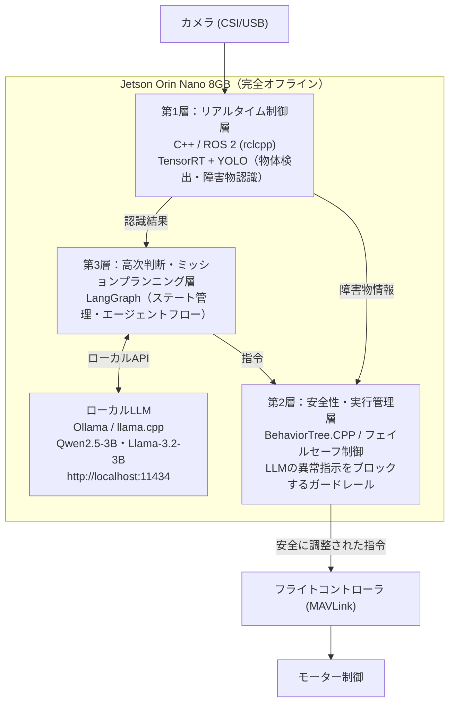
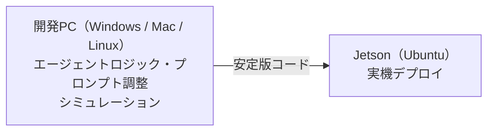

# ドローン完全ローカル構成：LangGraph ＋ ローカルLLM ＋ ROS 2

屋外飛行や通信圏外、セキュリティ・レイテンシの観点から、ドローンの頭脳を機体上のコンパニオンコンピュータ（例：NVIDIA Jetson Orin Nano 8GB）だけで完結させる構成。クラウドへの通信は一切行わない。

## 1. システム構成フロー

ポイント

- 第1層の認識結果は、判断を担う第3層と安全を担う第2層の両方に渡る。
- LLMの指示は必ず第2層のガードレールを通過してからフライトコントローラへ届く。異常な指令は機体に到達する前にブロックされる。

## 2. ローカル環境でLangGraphを動かす仕組み

- LangGraphは軽量なPythonライブラリで、外部サーバーは不要。Jetson内のPython環境に `pip install langgraph` で導入できる。
- Ollama または llama.cpp をバックグラウンドのデーモンとして常駐させる。
- LangGraphのLLM呼び出しノードから、ローカルのOllamaエンドポイント `http://localhost:11434` にAPIリクエストを送る。
- これにより、LLM推論とエージェントループがすべて機体内で完結する。

## 3. 完全ローカル構築の注意点

### メモリ（VRAM）の奪い合い

Jetson Orin Nano 8GBでは、ローカルLLM・ROS 2・YOLO・OSがメモリを共有する。

| 用途 | 目安 |
|---|---|
| ローカルLLM（3B・4bit量子化） | 約2〜3GB |
| ROS 2 / YOLO / OS | 残りを共有 |

モデルを大きくしすぎるとメモリ不足になるため、1.5B〜3Bクラスの軽量モデル（Qwen2.5、Llama-3.2など）を選ぶのが定石。

### 開発はPC、デプロイはJetson

LangGraphのロジックやプロンプト調整、シミュレーションは手元の高性能マシンで行い、安定したコードをJetsonへ持ち込む開発スタイルが効率的。

## 4. 次のステップ候補

1. 手元のPC・シミュレータで「Ollama ＋ LangGraph」のローカルエージェントを試作する
2. Jetsonの具体的なセットアップ手順を確認する
