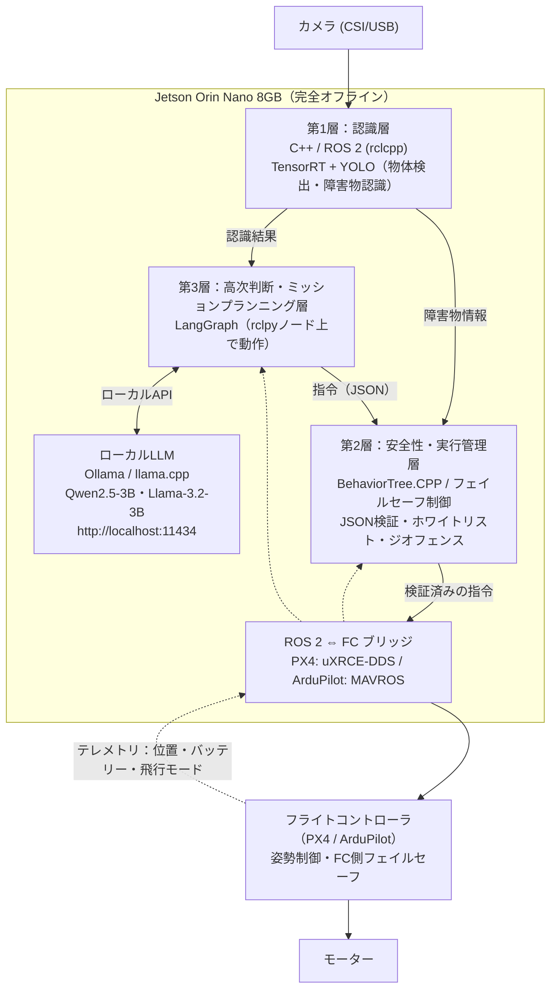
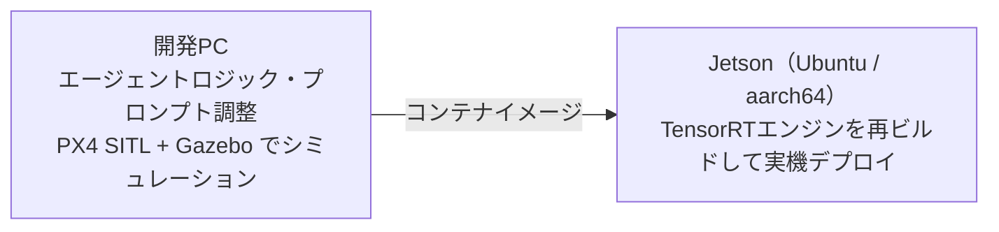

# ドローン完全ローカル構成：LangGraph ＋ ローカルLLM ＋ ROS 2

屋外飛行や通信圏外、セキュリティ・レイテンシの観点から、ドローンの頭脳を機体上のコンパニオンコンピュータ（例：NVIDIA Jetson Orin Nano 8GB）だけで完結させる構成。クラウドへの通信は一切行わない。

## 1. システム構成フロー

実線は指令の流れ、点線はFCからのテレメトリ（状態のフィードバック）を表す。

### 層番号について

層番号は処理の流れの順ではなく、応答速度と抽象度の順（第1層が最も速く低レベル、第3層が最も遅く高レベル）で振っている。データは「第1層 → 第3層 → 第2層 → FC」の順に流れる。

### 設計上のポイント

- **LLMは制御ループに入れない**：3Bクラスのモデルでもエージェントの1ループは秒単位かかる。第2層は第3層に依存せず、単独で安全判断ができるようにする。
- **第3層タイムアウト時の動作を決めておく**：第3層の応答が規定時間内に来ない、または異常終了した場合、第2層がホバリングまたは帰還（RTL）へ移行する。
- **LLM出力は構造化して検証する**：LLMにはJSONスキーマで出力を固定させる。第2層では許可コマンドのホワイトリスト、ジオフェンス、高度・速度の上限で検証し、外れた指令は破棄する。
- **フェイルセーフは多段にする**：第2層のフェイルセーフに加え、FC自身のフェイルセーフ（低電圧、通信断、ジオフェンス逸脱時の動作）を最後の砦として必ず有効にしておく。
- **リアルタイム制御はFCの役割**：姿勢制御などの高速な制御ループはFCが担う。Jetson側は認識・判断・指令の生成に専念する。

## 2. ローカル環境でLangGraphを動かす仕組み

- LangGraphは軽量なPythonライブラリで、外部サーバーは不要。Jetson内のPython環境に `pip install langgraph` で導入できる。
- Ollama または llama.cpp をバックグラウンドのデーモンとして常駐させる。
- LangGraphはROS 2のPythonノード（rclpy）として動かし、トピック経由で認識結果とテレメトリを受け取る。
- LangGraphのLLM呼び出しノードから、ローカルのOllamaエンドポイント `http://localhost:11434` にAPIリクエストを送る。
- これにより、LLM推論とエージェントループがすべて機体内で完結する。

## 3. 完全ローカル構築の注意点

### メモリの奪い合い

JetsonはCPUとGPUで同じメモリを共有する（ユニファイドメモリ）。Orin Nano 8GBでは、ローカルLLM・ROS 2・YOLO・OSがこの8GBを分け合う。

| 用途 | 目安 |
|---|---|
| ローカルLLM（3B・4bit量子化）の重み | 約2〜3GB |
| LLMのKVキャッシュ | コンテキスト長に比例して増加 |
| ROS 2 / YOLO / OS | 残りを共有 |

対策

- 1.5B〜3Bクラスの軽量モデル（Qwen2.5、Llama-3.2など）を選ぶ。
- コンテキスト長に上限を設け、KVキャッシュの増加を抑える。
- デスクトップGUIを無効にし、ヘッドレスで運用する。

### 開発はPC、デプロイはJetson

LangGraphのロジックやプロンプト調整、シミュレーションは手元の高性能マシンで行い、安定したコードをJetsonへ持ち込む。ただし、そのまま動くとは限らない点に注意する。

- 開発PC（多くはx86）とJetson（ARM / aarch64）ではアーキテクチャが異なる。Docker（jetson-containersなど）で環境を揃える。
- TensorRTのエンジンファイルはGPUごとに最適化されるため、Jetson上で再ビルドが必要。
- シミュレーションはPX4 SITL＋Gazeboで行い、FCとのやり取りやフェイルセーフの動作まで確認してから実機に移る。

## 4. 次のステップ候補

1. 手元のPC・シミュレータで「Ollama ＋ LangGraph」のローカルエージェントを試作する
2. 第2層のガードレール（JSONスキーマ、ホワイトリスト、タイムアウト時動作）を先に定義する
3. Jetsonの具体的なセットアップ手順を確認する
