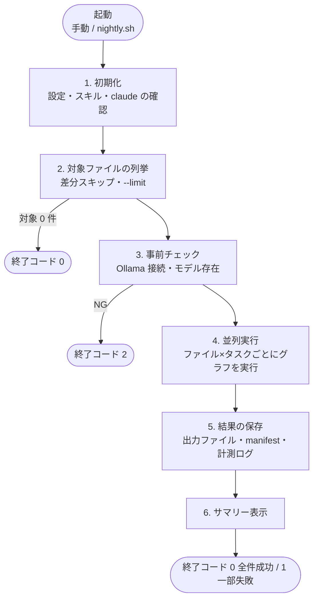
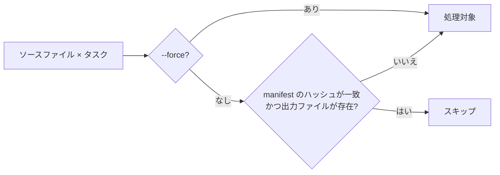
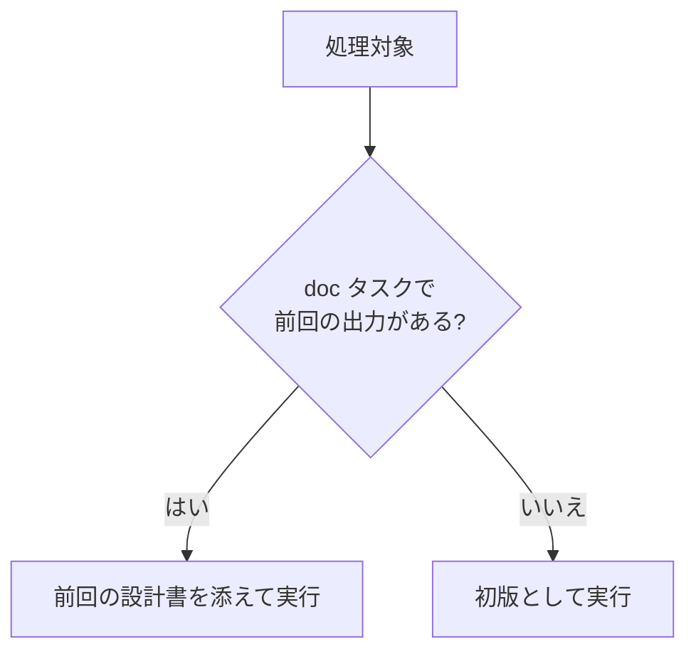
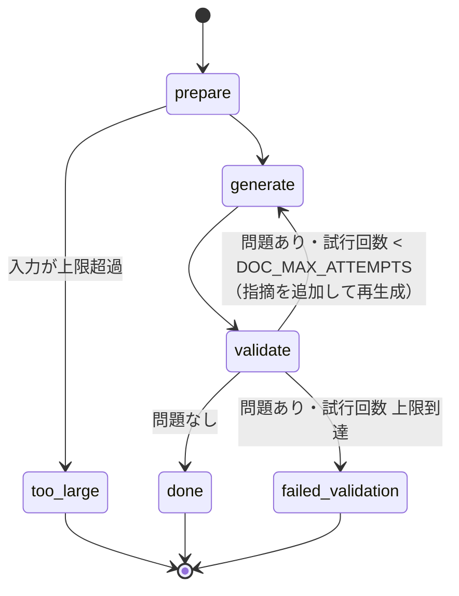
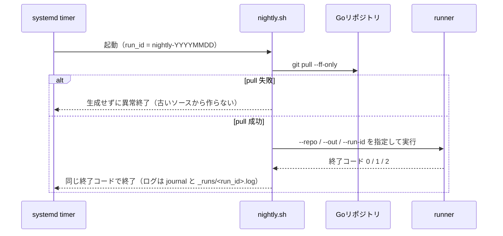

# 処理ワークフロー

runner（`python -m godoc_agent.runner`）を1回起動したときに、内部で何がどの順番で行われるかをまとめる。
セットアップ・運用コマンドは [README](../README.md) を参照。

## 全体像



処理の単位は **ソースファイル1本 × タスク1つ**（方式A）。タスクは次の2種類で、流れは共通、中身（プロンプト・検証・出力先）だけが異なる（[tasks.py](../godoc_agent/tasks.py)）。

| タスク | 内容 | 出力先 | 前回の出力の引き継ぎ |
|---|---|---|---|
| `doc` | 詳細設計書（Markdown）の生成 | `<out>/<相対パス>.go.md` | する（履歴を残して改訂） |
| `comment` | ソースファイルへのコメント追記 | `<out>/_commented/<相対パス>` | しない（毎回元のソースから） |

## 1. 初期化

[runner.py](../godoc_agent/runner.py) の `main()` / `run()`。対象ファイルを走査する前に、設定ミスをまとめて検出する。

1. `.env` を読み込み、環境変数から設定を作る（[config.py](../godoc_agent/config.py)）。整数値・割合（`LLM_CTX_WARN_RATIO`）の不正はここで `ValueError`
2. `--repo` がディレクトリか確認し、`--out`・`--out/_runs`・チェックポイントDBのフォルダを作る
3. 今日の日付を**1回だけ**取得する（日付をまたいでも同じ実行の出力は同じ日付になる）
4. 実行するタスクを決める
   - `--tasks` 指定があればそれ
   - 省略時は `doc`、加えて `CLAUDE_COMMENT_SKILL_PATH` があれば `comment`
5. タスクごとに SKILL.md を読み込み、`claude` コマンドの存在を確認し、manifest（差分記録）を開く

ここで失敗した場合（SKILL.md がない、`claude` が見つからない等）は `エラー: ...` を表示して終了コード `2` で終わる。

## 2. 対象ファイルの列挙

[targets.py](../godoc_agent/targets.py) の `discover_source_files()` で、対象の設定ファイル（`targets.toml`、なければ `targets.example.toml`）に書かれた言語ごとに、その拡張子のファイルを `--repo` 配下から集めて絞り込む。ファイルの言語は拡張子で決まり、解析（公開識別子の抽出）とプロンプトの言語名に使われる。

既定（`targets.example.toml`）の条件は次のとおり。

| 条件 | 例 |
|---|---|
| `<xx>_api/pkg/handler/` 配下（サブディレクトリ含む）だけ | 対象：`user_api/pkg/handler/admin/role.go` |
| `vendor/`・`testdata/`・`node_modules/`・`.` で始まるディレクトリ配下は除外 | 除外：`user_api/pkg/handler/vendor/x.go` |
| `_test.go` は除外 | 除外：`user_api/pkg/handler/user_test.go` |

言語・対象・除外の変え方は [target_files.md](target_files.md) を参照。

各ファイルについて、ソースの SHA-256 を計算し、タスクごとに次を判定する。



最後に `--limit` があれば先頭からその件数に切り詰める（ファイル数ではなく **ファイル×タスク** の件数）。
ここで `run_id=... タスク=... 対象=N 件（変更なしでスキップ=M 件）` を表示する。対象が0件ならここで終了（終了コード `0`）。

## 3. 事前チェック

[preflight.py](../godoc_agent/preflight.py)。全件が同じ理由で失敗するのを防ぐため、Ollama に対して次を確認する。

- サーバーに接続できるか（`OLLAMA_BASE_URL`）
- モデル（`LLM_MODEL`）が存在するか

NG なら終了コード `2`。

## 4. 並列実行

- 処理対象ごとに非同期ジョブを作り、セマフォで同時実行数を `LLM_CONCURRENCY` に抑える（**タスクをまたいだ合計**。Ollama の `OLLAMA_NUM_PARALLEL` に合わせる）
- グラフの状態はチェックポイントとして保存しない。1ファイル×1タスクごとに毎回まっさらな状態から実行する
- 1件の例外でバッチ全体は止めず、その件を `error` として記録して次へ進む

### 4-1. 1件の実行（`process_file()`）



中断・失敗した実行の途中から再開する仕組みは持たない。再実行すると、完了済みのファイルは manifest（2章）でスキップされ、
中断・失敗したファイルだけが最初からやり直される。前回の会話（Claude Code のセッション）を引き継がないため、
膨らんだコンテキストのまま再開してコンテキスト超過を繰り返すことがない。

### 4-2. 1ファイル×1タスクのグラフ（`doc_graph.py`）

[doc_graph.py](../godoc_agent/doc_graph.py)。状態にはそのファイルの情報しか入らないため、前のファイルのコンテキストは混ざらない。



| ノード | 処理 |
|---|---|
| `prepare` | 入力サイズ（ソース + 前回の出力の文字数）を上限と比較。超えたら `too_large`。超えなければ静的解析で事実（package・imports・types・functions）を抽出し、最初のメッセージを組み立てる |
| `generate` | Claude Code を1回実行し、応答から全体を囲む ```` ``` ```` を外して下書きにする。計測値（ターン数・入出力トークン数・所要時間）を残す |
| `validate` | タスクごとの検証を行い、`done` / 再生成 / `failed_validation` を決める。再生成では、最初の依頼文に直前の出力と指摘を追記したメッセージを作り直す（会話は積み上げない） |

入力サイズの上限（[config.py](../godoc_agent/config.py)）は「1トークン≒3文字」の概算で決める。

| タスク | 上限（文字数） | 既定値での目安 |
|---|---|---|
| `doc` | `LLM_NUM_CTX × 1.5` | 約 98,000 文字 |
| `comment` | `min(LLM_NUM_CTX × 1.5, LLM_NUM_PREDICT × 1.5)` | 約 12,000 文字（全文を出力するため出力上限にも収める） |

### 4-3. 検証の内容

構成や書き方はスキルに任せ、プログラムで確実に判定できることだけを検証する（[tasks.py](../godoc_agent/tasks.py)）。

| タスク | 不合格の条件 | 再生成時の指摘 |
|---|---|---|
| `doc` | 本文が空 / 公開識別子（大文字始まりの型・関数・メソッド名）が単語境界で見つからない | 記載されていない識別子の一覧 |
| `comment` | 本文が空 / コメントと空白を除いたトークン列が元のソースと異なる | 差分が見つかった元ファイルの行番号 |

### 4-4. Claude Code の実行（`claude_code.py`）

[claude_code.py](../godoc_agent/claude_code.py)。`generate` から呼ばれ、`claude -p` をサブプロセスとして起動する。

| 項目 | 内容 |
|---|---|
| 作業ディレクトリ | `--repo`（エージェントは関連ファイルを自分で Read / Grep / Glob する） |
| ツール | `Read,Glob,Grep` のみ。ファイルの保存は runner が行う |
| 追加ディレクトリ | SKILL.md のあるフォルダ（`--add-dir`。スキルの参照ファイル用） |
| システムプロンプト | バッチ用ルール + SKILL.md 全文（毎回 `--append-system-prompt`） |
| 再生成 | `--resume` はせず、新しいセッションで起動する。依頼文は「最初の依頼＋直前の出力（`<previous_attempt>`）＋指摘」。試行を重ねても入力は「初回＋直前の出力1つ分」で頭打ちになり、前の試行でツールが読んだ内容も持ち越さない（関連ファイルは必要なら読み直す） |
| モデル接続 | `ANTHROPIC_BASE_URL` を Ollama に向け、opus/sonnet/haiku すべてを `LLM_MODEL` にする |
| 外部通信 | `CLAUDE_CODE_DISABLE_NONESSENTIAL_TRAFFIC=1`、`--strict-mcp-config` で MCP を読まない |
| 上限 | ターン数 `CLAUDE_MAX_TURNS`、出力トークン `LLM_NUM_PREDICT`、時間 `CLAUDE_TIMEOUT_S`（超過で kill） |

次の場合は例外（`ClaudeCodeError`）となり、そのファイルは `error` として記録される。

- タイムアウト
- 出力が JSON として読めない
- 終了コードが0以外、または `is_error`（例：`subtype=error_max_turns`）

成功した場合は、JSON 出力の `usage` から次を応答に残し、`generate` が計測ログの `llm_calls[]` に記録する。`usage` やその項目がない場合（Ollama が返さない場合など）は `null` とし、エラーにはしない。

| 項目 | 内容 |
|---|---|
| `output_tokens` | 出力トークン数 |
| `input_tokens` / `cache_read_input_tokens` / `cache_creation_input_tokens` | 入力トークン数（プロンプトキャッシュ分は `input_tokens` に含まれないため別々に残す） |
| `total_input_tokens` | 上の入力3項目のうち値のあるものの合計。すべて `null` なら `null`（`doc_graph.py` で計算） |

### 4-5. プロンプトの構成（`prompts.py`）

[prompts.py](../godoc_agent/prompts.py)。

```
システム: バッチ用ルール（スキルより優先）
          - ファイル作成・編集・コマンド実行をしない
          - 成果物の本文だけを返す（前置き・``` なし）
          - 質問しない
          - スキルの参照ファイルの場所、今日の日付
          <skill> SKILL.md 全文 </skill>

ユーザー: 対象ファイルの相対パス
          抽出済みの事実（package / imports / types / functions）
          doc     : 前回の設計書（あれば「履歴を残して改訂を1件追加」、なければ「初版」）
          comment : 現在のファイルの全文
```

## 5. 結果の保存

ジョブは完了した順に処理する（`asyncio.as_completed`）。1件終わるごとに次を行うため、途中で落ちても進捗は残る。

1. `status = done` なら出力ファイルを書き出す（フォルダ構成は `--repo` からの相対パスと同じ）
2. 同じく `done` なら manifest にソースのハッシュを記録する（一時ファイル経由で置き換え、破損を防ぐ）
3. 計測ログ `<out>/_runs/<run_id>.jsonl` に1行追記する（本文は含めない）
4. `[i/N] <status> <秒>s <タスク> <相対パス> (問題点) [警告: ...]` を表示する（問題点は `done` 以外、警告はあれば `done` でも出る）

`done` 以外では出力ファイルも manifest も更新しない。そのため次回の実行で再び処理対象になる。

計測ログに書く前に、`llm_calls[]` の各実行の `total_input_tokens` が `LLM_NUM_CTX × LLM_CTX_WARN_RATIO`（既定 0.9）を超えていないかを確認し、超えていれば `warnings` に残す（`runner.py` の `context_warnings()`）。Ollama は `OLLAMA_CONTEXT_LENGTH` を超えた分を黙って切り捨てるため、検証に合格していても入力の一部が読まれていない可能性を示すためのもの。合否（`status`）は変えず、`issues`（検証の指摘）とも分けている。

## 6. サマリーと終了コード

終了時に次を表示する。

- 対象件数・経過時間
- タスクごとのステータス別件数
- Claude Code の実行回数・平均ターン数
- 入力トークン数（1回あたり）の最大値・平均値（値が取れた実行だけで集計。1回も取れなければ表示しない）
- 入力トークン数の警告が出た件数（あれば）
- 成功1件あたりの平均処理時間・失敗率

| 終了コード | 意味 |
|---|---|
| `0` | 全件 `done`（または対象0件） |
| `1` | 一部が `done` 以外（詳細は計測ログ） |
| `2` | 設定・接続エラーで開始できず |

## ステータス一覧

| ステータス | 発生箇所 | 意味 | 次回の扱い |
|---|---|---|---|
| `done` | validate | 検証に合格し、出力を保存した | ソースが変わるまでスキップ |
| `too_large` | prepare | 入力が上限を超えたため実行しなかった | 毎回対象になる（設定を見直すまで） |
| `failed_validation` | validate | `DOC_MAX_ATTEMPTS` 回生成しても検証に通らなかった | 再実行で対象になる |
| `error` | process_file | Claude Code の異常終了・タイムアウトなどの例外 | 再実行で対象になる |

## 夜間実行の流れ

[deploy/nightly.sh](../deploy/nightly.sh) を systemd タイマー（毎日 2:00）が起動する。



## 生成物の一覧

| パス | 内容 |
|---|---|
| `<out>/<相対パス>.go.md` | 詳細設計書 |
| `<out>/.manifest.json` | 設計書の差分スキップ用ハッシュ |
| `<out>/_commented/<相対パス>` | コメント追記済みのファイル（対象リポジトリは書き換えない） |
| `<out>/_commented/.manifest.json` | コメント追記の差分スキップ用ハッシュ |
| `<out>/_runs/<run_id>.jsonl` | 計測ログ（1ファイル×タスク = 1行） |
| `<out>/_runs/<run_id>.log` | 標準出力のログ（tmux / nohup / nightly.sh で起動した場合） |
